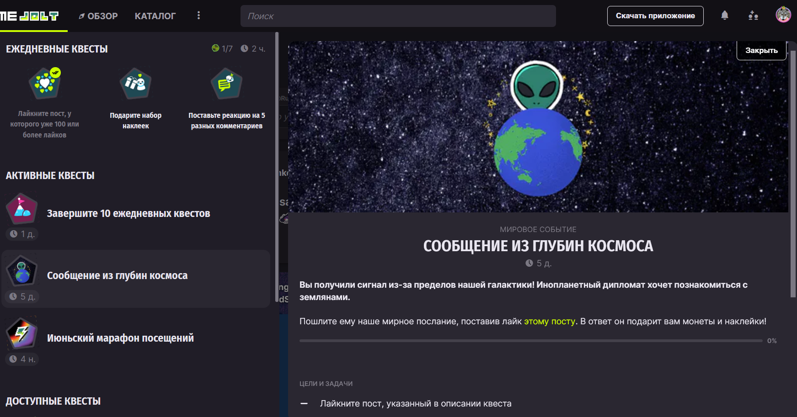

# Русская локализация Game Jolt Дефлеката

    

 

Неофициальная русская локализация для [Game Jolt](https://gamejolt.com/), реализованная в виде пользовательского сценария для [Tampermonkey](https://github.com/Tampermonkey/tampermonkey).

## Установка

1. Установите Tampermonkey или его аналог.
2. Откройте ссылку на сценарий c [GitHub](https://github.com/RushanM/Game-Jolt-ru-RU-L10n/raw/master/GJ-Ru-L10n.user.js) или [GreasyFork](https://greasyfork.org/ru/scripts/496844-game-jolt-russian-translation).
3. Установите сценарий.
4. Обновите страницу Game Jolt, если она была открыта.
5. Готово!

## Материальная поддержка

Если моя работа нравится вам настолько, что вы готовы отправить мне деньги, можно сделать это по следующим ссылкам:

* [Boosty](https://boosty.to/rushanm),
* [Donation Alerts](https://www.donationalerts.com/r/deflecat),
* [Ozon Банк](https://finance.ozon.ru/apps/sbp/ozonbankpay/019bc8c0-c2b4-74bb-8409-3428eb77d6b1),
* [ЮMoney](https://yoomoney.ru/to/410015215253910),
* [VK Donut](https://vk.com/deflcomm?w=donut_payment-71906125&levelId=106).

Буду благодарен за каждый рубль!
